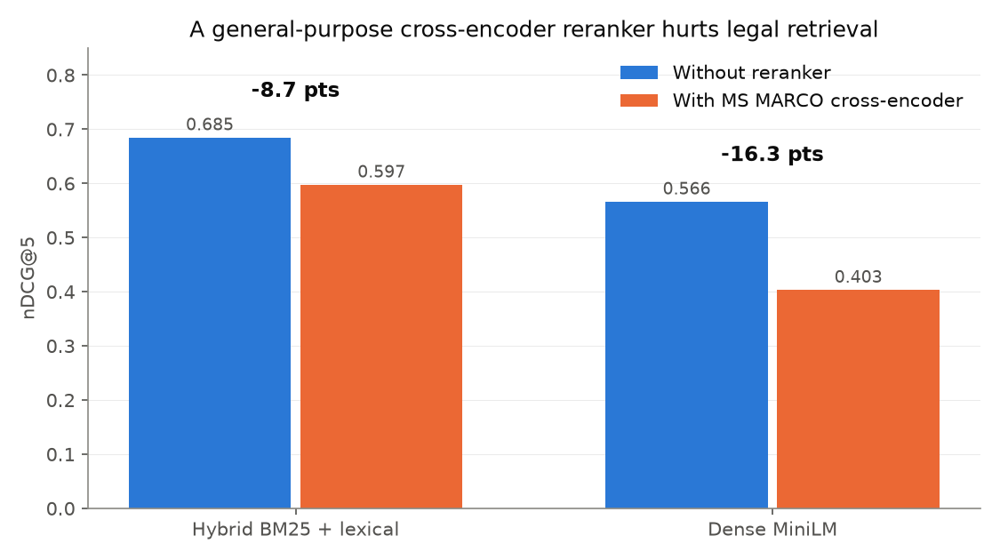
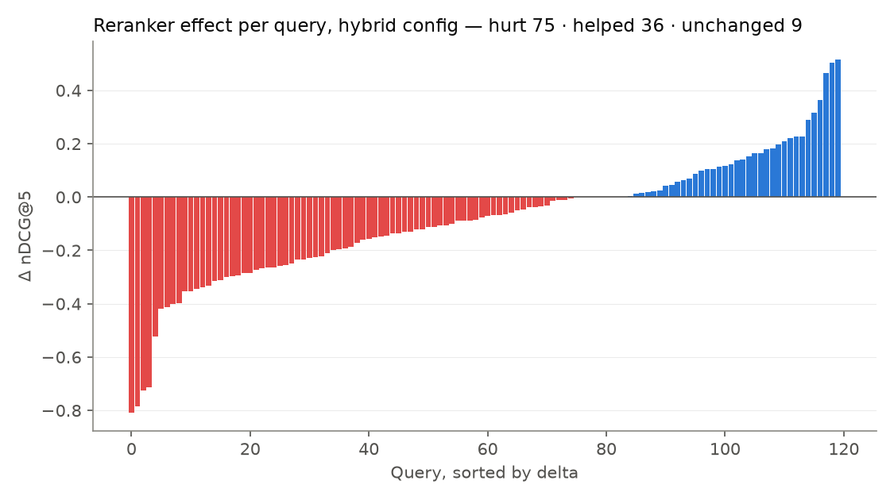
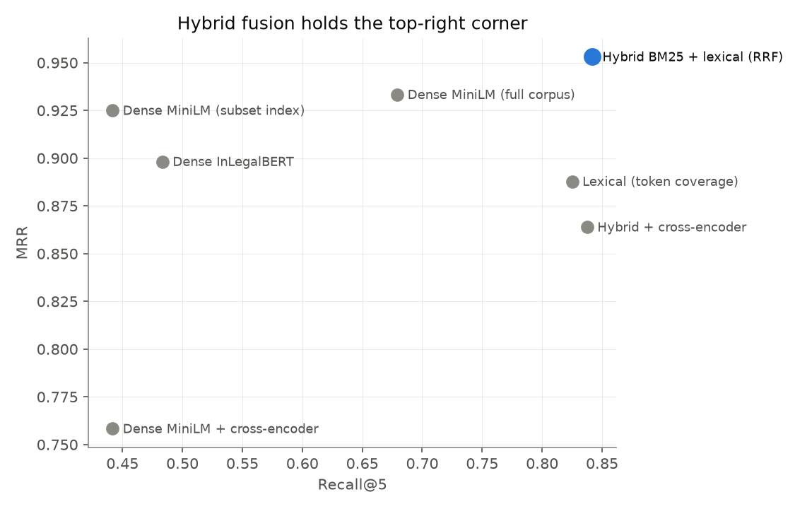
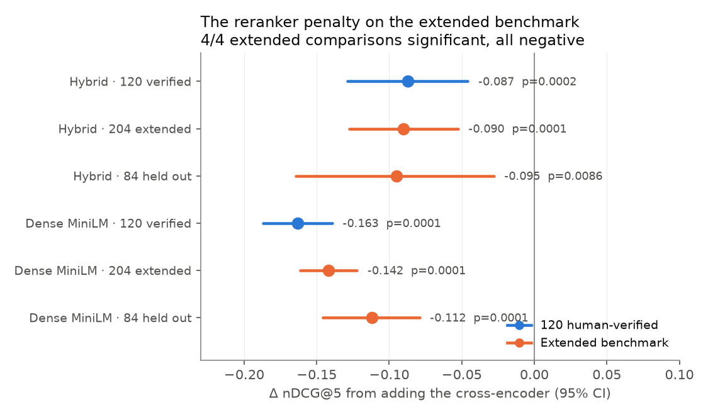
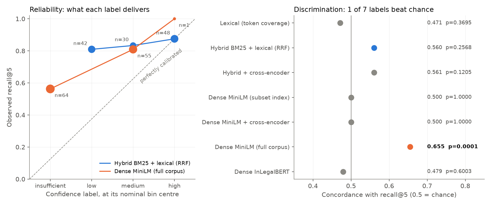

# rag-eval-lab

**A reproducible retrieval benchmark with a negative result: on specialist legal text, a general-purpose cross-encoder reranker makes retrieval *worse* — by 8.7 to 16.3 nDCG points, p ≤ 0.0002.**

[](https://github.com/Bruhadev45/rag-eval-lab/actions/workflows/ci.yml)
[](LICENSE)



Every number in this repository — every table cell, figure, confidence interval, and p-value — is recomputed from committed per-query records by one command:

```bash
make reproduce
```

No API keys, no model downloads, no corpus. The analysis is deterministic (seeded bootstrap and permutation tests), so your run produces byte-identical results to CI's.

## The setup

[JurisGPT](https://github.com/Bruhadev45/Juris-GPT) is a citation-grounded RAG assistant over 47,867 Indian statutory documents, published as an IEEE paper. Its retrieval was evaluated on a **120-query human-verified benchmark** (Fleiss' κ = 0.81 among annotators) across six legal categories, in seven configurations:

| Configuration | Recall@5 | Precision@5 | MRR | nDCG@5 |
|---|---|---|---|---|
| Lexical (token coverage) | 0.8250 | 0.8633 | 0.8878 | 0.7849 |
| **Hybrid BM25 + lexical (RRF)** | **0.8417** | 0.7233 | **0.9531** | 0.6846 |
| Hybrid + cross-encoder | 0.8375 | 0.7733 | 0.8639 | 0.5974 |
| Dense MiniLM (subset index) | 0.4417 | 0.9250 | 0.9250 | 0.5661 |
| Dense MiniLM + cross-encoder | 0.4417 | 0.6167 | 0.7583 | 0.4032 |
| Dense MiniLM (full corpus) | 0.6792 | 0.9067 | 0.9333 | 0.6771 |
| Dense InLegalBERT | 0.4833 | 0.8883 | 0.8982 | 0.7800 |

This repository ships the raw per-query records for all seven runs (`data/runs/`, 7 × 120 rows), a wider 204-query re-run of five of them (`data/runs-ext204/`), and the analysis that turns them into claims.

## Finding 1 — the reranker penalty (significant)

Adding a MS MARCO cross-encoder (`cross-encoder/ms-marco-MiniLM-L-6-v2`) on top of retrieval **lowered nDCG@5 in every configuration tested**:

| Comparison | Δ nDCG@5 | 95% CI | p |
|---|---|---|---|
| Hybrid → Hybrid + reranker | **−0.0871** | [−0.129, −0.046] | 0.0002 |
| Dense → Dense + reranker | **−0.1629** | [−0.187, −0.139] | 0.0001 |

Paired bootstrap CIs and two-sided sign-flip permutation tests, 10,000 resamples, both configurations answering the same 120 queries.

The damage is not an outlier effect. Per query, the reranker **hurt 75 of 120 queries and helped 36**:



Why this matters: "add a reranker" is default advice in RAG engineering. On a specialist corpus it transferred negatively — a model trained on web-search relevance does not know that *Section 149* answering a board-composition question matters more than a passage that merely shares vocabulary. Retrieval quality on specialist corpora is **corpus-bound, not retriever-bound**. Measure before you stack components.

## Finding 2 — what hybrid fusion actually buys (and what it doesn't)

Fusing BM25 with lexical retrieval via weighted Reciprocal Rank Fusion (the extraction of which became [ragfuse](https://github.com/Bruhadev45/ragfuse)) against the lexical baseline:

| Metric | Δ | 95% CI | p | Verdict |
|---|---|---|---|---|
| MRR | +0.0653 | [+0.023, +0.111] | 0.0025 | **significant** |
| Recall@5 | +0.0167 | [−0.013, +0.046] | 0.44 | *not significant* |

So the honest sentence is narrower than the flattering one: on this benchmark, hybrid fusion **reliably puts the first relevant statute higher** (MRR), while its recall improvement is within noise at n=120. Both facts are asserted as tests in `tests/test_analysis.py` — if the data or the analysis ever stops supporting them, CI fails. Read the next section before quoting the MRR win: it does not survive on the wider query set.



## Does the reranker penalty replicate out of domain?

Mostly yes — and the replication also costs this repository one of its other claims.

The same harness ran five of these configurations on a wider **204-query** set, shipped here as `data/runs-ext204/`. Be precise about what that set is: it is the original 120 human-verified queries **plus 84 auto-generated ones** over document types the benchmark never covered — raw statutes, case law, FAQ and clause text. The 84 were generated from the corpus, not labelled by annotators, so they are weaker labels over wider ground, not a second human-verified benchmark. The analysis therefore reports them as a separate held-out subset, because those 84 queries are the only genuinely out-of-sample evidence here.



**The penalty replicates.** Δ nDCG@5 from adding the cross-encoder, in every query set:

| Configuration | 120 human-verified | 204 extended | 84 held out |
|---|---|---|---|
| Hybrid + cross-encoder | −0.0871 (p = 0.0002) | −0.0904 (p = 0.0001) | −0.0951 (p = 0.0086) |
| Dense + cross-encoder | −0.1629 (p = 0.0001) | −0.1419 (p = 0.0001) | −0.1119 (p = 0.0001) |

All four extended-set comparisons are negative and significant, with effect sizes inside the original confidence intervals. On queries the original benchmark never asked, over document types it never covered, a general-purpose cross-encoder still makes this retrieval worse.

**But the damage arrives differently.** On the 120, the reranker's harm showed up in MRR (−0.0892, p = 0.0006) while recall@5 was untouched (−0.0042, p = 1.0): it demoted the *first* relevant statute. On the extended set that flips — MRR is no longer significant (−0.0477, p = 0.074) while recall@5 drops significantly (−0.0711, p = 0.0012): it pushes relevant documents out of the top 5 entirely. Same verdict, different mechanism, which is a reason to quote the nDCG number rather than any single-rank metric.

And per query on the held-out 84, the reranker **hurt 42 and helped 42** — a dead-even split whose mean is still clearly negative. It does not damage more queries out of domain; it damages them harder than it helps.

**Finding 2 does not survive.** Hybrid fusion's MRR win over the lexical baseline (+0.0653, p = 0.0025 on the 120) vanishes on the extended set (−0.0184, p = 0.38) and *reverses* on the held-out 84 (−0.1379, p = 0.0002). One plausible reading: queries auto-generated from document text reward exact token overlap, which is precisely what the lexical retriever optimises — so the query generator may be doing the work, not the retriever. Either way, the honest statement is now narrower than the one in Finding 2: hybrid fusion's ranking gain is **benchmark-bound**, demonstrated on the 120 human-verified queries and not beyond them. The test `test_hybrid_mrr_gain_does_not_replicate` keeps this section from quietly drifting back to the flattering version.

## Is the confidence label worth anything?

Every per-query record also carries the harness's `confidence` label — `insufficient`, `low`, `medium` or `high` — which JurisGPT assigns from retrieval-similarity thresholds before any answer is generated (`_assess_confidence` in its `data/rag_pipeline.py`) and shows to users as a confidence badge. If it worked, it would be a free signal for when to trust retrieval. Measured against recall@5 on the 120 human-verified queries, **mostly it does not.**



A label can fail in two independent ways, so the analysis asks two questions:

- **Calibration** — does the label mean what it says? The label is ordinal, not a probability, so expected calibration error (ECE) reads each level as the centre of one of four equal-width bins: insufficient 0.125, low 0.375, medium 0.625, high 0.875.
- **Discrimination** — does a higher label at least go with better retrieval? Concordance is the probability that, of two queries where one retrieved more of its expected sources, the label ranks that one higher (0.5 = a coin flip). It needs no probability reading, and a seeded label-shuffling permutation test gives its p-value.

| Configuration | Levels used | Recall never falls as label rises* | ECE | Concordance | p |
|---|---|---|---|---|---|
| Lexical (token coverage) | 3 | no | 0.0875 | 0.4714 | 0.3695 |
| Hybrid BM25 + lexical (RRF) | 3 | yes | 0.2042 | 0.5604 | 0.2568 |
| Hybrid + cross-encoder | 3 | yes | 0.2125 | 0.5607 | 0.1205 |
| Dense MiniLM (subset index) | 1 | — | 0.1833 | 0.5000 | 1.0000 |
| Dense MiniLM + cross-encoder | 3 | — | 0.1875 | 0.5000 | 1.0000 |
| Dense MiniLM (full corpus) | 3 | yes | 0.3187 | **0.6548** | **0.0001** |
| Dense InLegalBERT | 4 | no | 0.3542 | 0.4794 | 0.6003 |

\* Over levels holding at least 5 queries, so a single query in a sparse level cannot decide it; — means fewer than two levels qualify.

**Calibrated: no.** Under the bin-centre reading ECE runs from 0.0875 to 0.3542. The shipped hybrid pipeline is *under*-confident by 20 points: the queries it labels `low` still retrieve 0.8095 of their expected sources (n = 42), barely below the 0.8750 of its `high` queries (n = 48).

**Discriminating: one label in seven.** Hybrid's ordering points the right way (0.8095 → 0.8333 → 0.8750), but its concordance of 0.5604 (p = 0.26) is indistinguishable from shuffled labels. Only the full-corpus dense MiniLM label ranks queries better than chance (0.6548, p = 0.0001 — the smallest a 10,000-resample test can report, and small enough to survive a Bonferroni correction for the seven configurations) — and it is also badly calibrated: the queries it marks `insufficient`, the badge that tells a user the corpus cannot answer, still retrieve 0.5625 of their expected sources (n = 64).

**A low ECE is not a useful label.** Lexical has the best ECE (0.0875) only because it says `high` on 103 of 120 queries and delivers 0.8204 recall on them, close to what `high` claims; its concordance is 0.4714 (p = 0.37), no better than chance. Dense MiniLM on the subset index labels all 120 queries `medium`, so it cannot rank anything, and InLegalBERT's `insufficient` queries (0.7143) out-retrieve its `high` ones (0.4552).

So on this benchmark the label is worth little as a probability, and as a ranking only for one dense configuration — not for the hybrid pipeline JurisGPT ships. One plausible reading: the label comes from fixed similarity cut-offs, and a similarity score means different things under different retrievers. Two limits on the claim: this measures the label against *retrieval* only (whether it tracks answer faithfulness is a question this data cannot answer), and the ECE values depend on the bin-centre reading while the concordance results do not. `tests/test_calibration.py` pins every number in the prose above; the table is copied from `results/TABLES.md`, which CI regenerates byte for byte.

## Reproduce it

```bash
git clone https://github.com/Bruhadev45/rag-eval-lab
cd rag-eval-lab
python -m venv .venv && source .venv/bin/activate
pip install -e ".[dev]"

make reproduce   # rewrites results/ from data/runs/ — diff should be empty
make test        # pins the findings to the data; fails under 85% coverage
```

`make reproduce` overwrites `results/results.json`, `results/TABLES.md`, and every figure in place. After a fresh clone the git diff is empty — that's the reproducibility check, and CI enforces it on every push.

## How the analysis works

```
data/runs/*.json          7 configs × 120 per-query records (the ground truth)
data/runs-ext204/*.json   5 configs × 204 per-query records (the extended set)
data/benchmark_queries.json   the 120 queries and their expected sources
src/rageval/loading.py    loads runs, validates stored aggregates against
                          recomputed means, aligns query ids across configs
src/rageval/stats.py      paired bootstrap CI + sign-flip permutation test,
                          seeded, stdlib-only
src/rageval/ext204.py     the extended benchmark: all-204 and held-out-84
                          comparisons, and the replication figure
src/rageval/calibration.py  confidence label vs recall@5: reliability table,
                          ECE, concordance + permutation test, figure
src/rageval/figstyle.py   one palette and axis style for every figure
src/rageval/report.py     recomputes every table, figure, and results.json
tests/test_analysis.py    pins the published findings to the data
tests/test_ext204.py      pins the replication findings to the data
tests/test_calibration.py pins the calibration findings to the data
tests/test_cli.py         runs `python -m rageval.report --root <tmp>` on a
                          copy of data/ and requires byte-identical output
src/rageval/legal_demo/   the separate fictional legal-demo set: label
                          checks, frozen splits, results/legal-demo/ report
```

Design choices worth naming:

- **Aggregates are never trusted.** `loading.py` recomputes every mean from per-query rows and raises if it disagrees with the stored value beyond rounding. The inputs police themselves.
- **All comparisons are paired.** Both configs answered the same queries, so the unit of analysis is the per-query difference — far more sensitive than comparing independent means, and the honest choice on a fixed query set.
- **The findings are tests.** `test_reranker_penalty_on_hybrid_is_8_7_points` is a real test name. A refactor that moved the number would fail, not silently rewrite the README.

## Provenance and limitations

- Runs were produced by the JurisGPT evaluation harness (repo: `data/eval/results/` there — `eval_*.json` for the 120, `ext204_eval_*.json` for the 204) in July 2026; this repository is the analysis layer over their committed outputs, so the retrieval systems themselves are not re-executed here.
- n=120 with human-verified labels is respectable for a domain benchmark and still small: effects under ~3 points routinely land inside the CI, as the recall result shows.
- Relevance is binary. Graded labels would sharpen nDCG.
- The 84 held-out queries are auto-generated from the corpus, not human-verified. They widen the document types under test, not the labelling standard — which is why they are reported separately rather than pooled into the headline.
- One corpus, one language pair (English-language Indian statutes). The reranker result is a warning about *unmeasured transfer*, not a claim that rerankers are bad.

## Legal demo: frozen evaluation splits (fictional)

A second, separate evaluation set lives in `data/legal-demo/`. It holds 30
labelled cases (46 queries) over six **fictional** legal-like sources from
[minirag](https://github.com/Bruhadev45/minirag)'s legal example. The cases are
answerable, unanswerable, unknown-metadata, wrong-regime, outdated and
conflicting-source questions, each with verbatim evidence quotes and the traps
a correct system must not use. They are frozen into train/dev/test before any system has run on
them, and kept apart from the historical results above.

```bash
python -m rageval.legal_demo   # checks every label, writes results/legal-demo/
```

The command fails if any of these break:

- A quote does not occur exactly once in its section.
- An evidence passage is ineligible for its requester, jurisdiction or date, or a trap is eligible.
- Related cases (shared issue, any version of the same provision, conflicting sources) cross a split. Grouping is by provision, not by whole source family, so one fictional Act has sections in all three splits.
- A file differs from the hash `manifest.json` pinned.

The labels were written by an AI coding assistant and have not been reviewed
by a person or a legal expert. The set tests software behaviour, not legal
accuracy, and no results have been measured on it yet. See
[`data/legal-demo/DATA_CARD.md`](data/legal-demo/DATA_CARD.md) for the method,
the eligibility rule and the limitations, and
[`results/legal-demo/SPLITS.md`](results/legal-demo/SPLITS.md) for the frozen
splits.

## License

MIT — see [LICENSE](LICENSE). The benchmark queries and per-query records come from the author's own JurisGPT evaluation.
